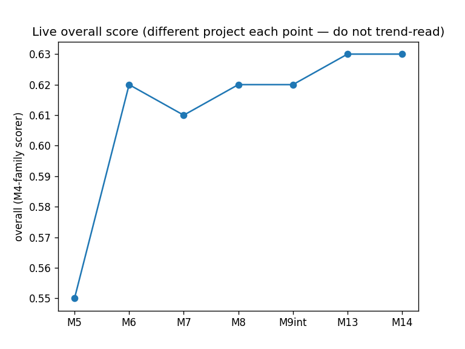
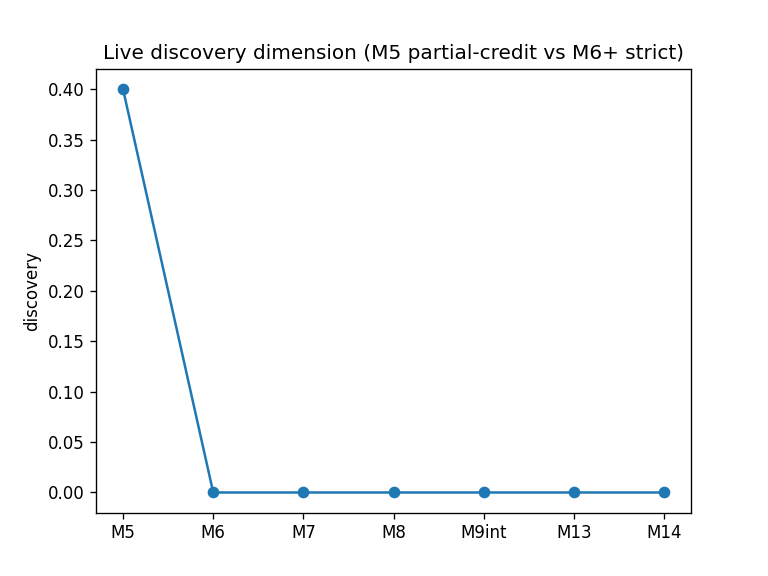
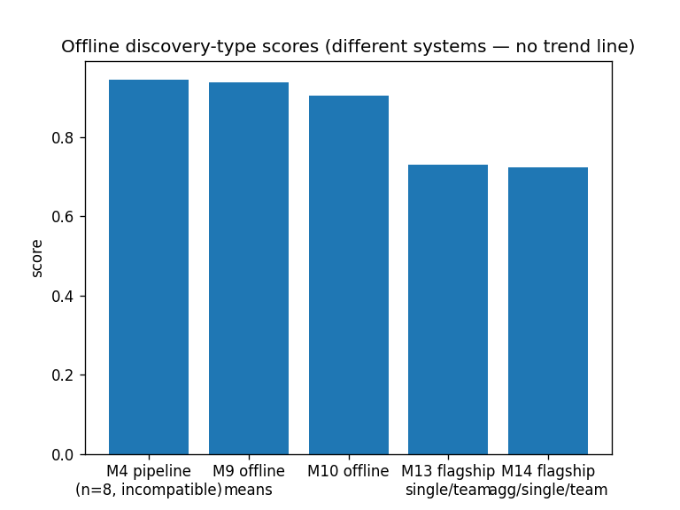
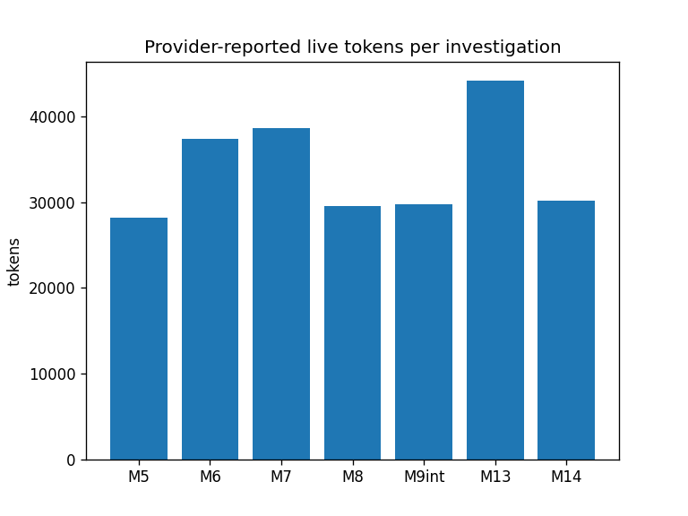
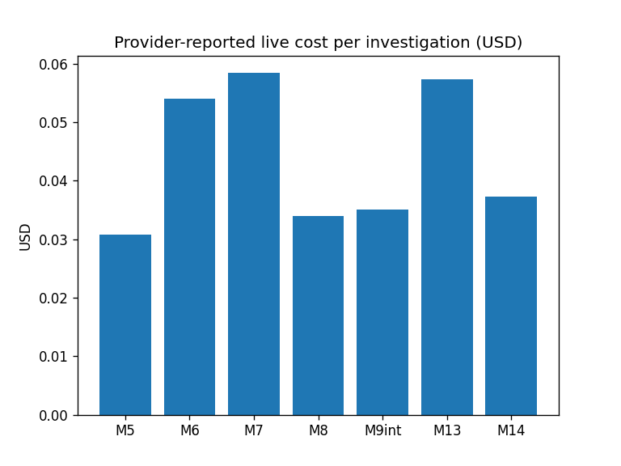
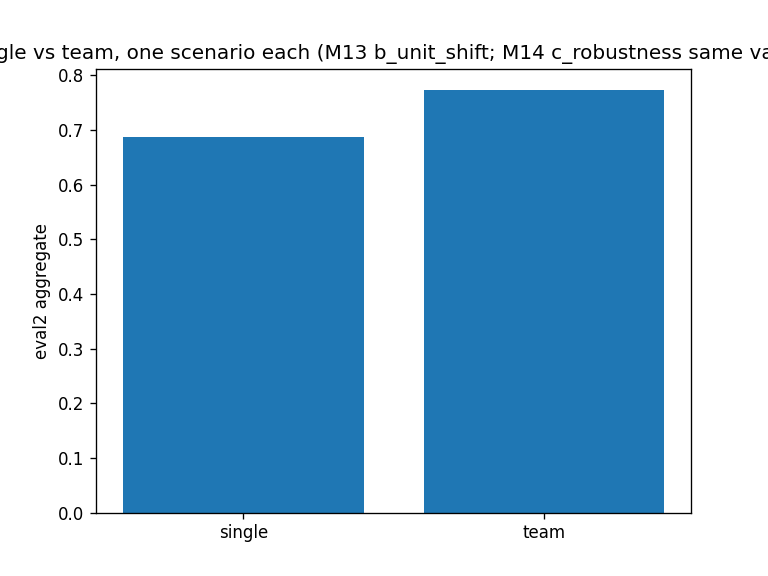
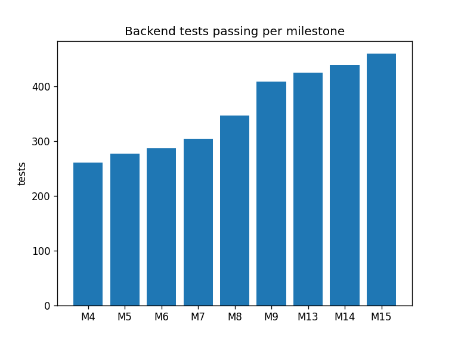
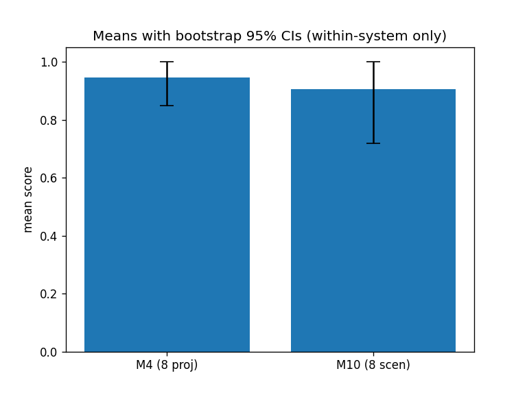
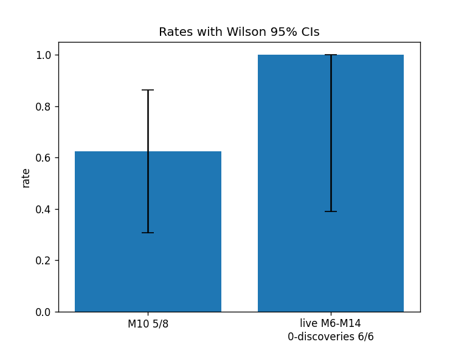
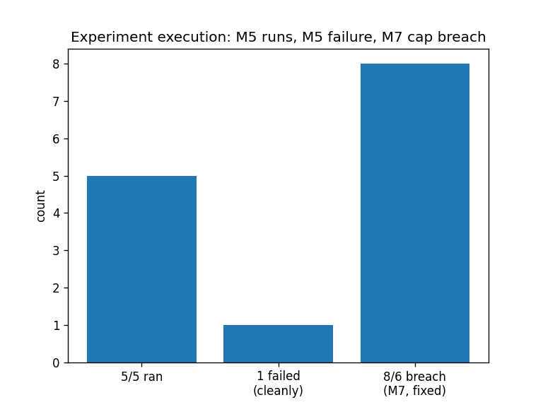

# Model Autopsy M4–M15: Comprehensive Quantitative Performance & Statistical Analysis

Generated 2026-11-01. **Read-only analysis**: no application code was modified, no paid APIs were called, no historical artifacts were altered. Every number below links to its artifact in the provenance appendix (§10).

> **Central warning.** Milestones do not share one evaluation system. M4's 0.945 is a deterministic-pipeline score over 8 synthetic projects; M5–M8/M9int/M13/M14 live scores are heuristic investigator scores on one project each; M9–M10/M13–M14 offline means are evidence-required discovery scores on different corpora. Any table that places them in one column must be read with §6 (methodology-compatibility) in mind. I do **not** compute p-values from aggregate milestone scores, and I do **not** rank milestones against each other across systems.

## 1. Milestone comparison table (all historically evidenced metrics)

`N/A` = not measured (never 0). Full machine-readable table: `MODEL_AUTOPSY_M4_M15_METRICS.csv`.

| Metric | M4 | M5 | M6 | M7 | M8 | M9 | M10 | M11 | M12 | M13 | M14 | M15 |
|---|---:|---:|---:|---:|---:|---:|---:|---:|---:|---:|---:|---:|
| Overall score | 0.945¹ | 0.55 | 0.62 | 0.61 | 0.62 | N/A² | 0.906³ | N/A | N/A | 0.63 | 0.63 | N/A⁴ |
| Discovery | N/A⁵ | 0.4⁶ | 0.0 | 0.0 | 0.0 | 0.938² | 0.906³ | N/A | N/A | 0.0 | 0.0 | N/A⁴ |
| Evidence quality | N/A | 0.5 | 1.0⁷ | 1.0⁷ | 1.0⁷ | N/A | N/A | N/A | N/A | 1.0⁷ | 1.0⁷ | N/A |
| Reasoning | N/A | 0.6 | 0.6 | 0.6 | 0.6 | N/A | N/A | N/A | N/A | 0.6 | 0.6 | N/A |
| Causal reasoning | N/A | N/A | 0.5 | 0.5 | qual⁸ | 0.75² | N/A | N/A | N/A | N/A | N/A | N/A |
| Confounder handling | N/A | N/A | N/A | N/A | N/A | 0.625² | N/A | N/A | N/A | N/A | N/A | N/A |
| Calibration (dim) | N/A | 0.5 | 1.0⁷ | 1.0⁷ | 1.0⁷ | N/A | N/A | N/A | N/A | 1.0⁷ | 1.0⁷ | N/A |
| Efficiency (dim) | N/A | 0.8 | 0.6 | 0.4⁹ | 0.6 | N/A | N/A | N/A | N/A | 0.8 | 0.8 | N/A |
| Reproducibility (dim) | N/A | 1.0 | 1.0 | 1.0 | 1.0 | N/A | N/A | N/A | N/A | 1.0 | 1.0 | N/A |
| Report validity | N/A | 0.0¹⁰ | 1.0 | 0.0¹⁰ | 0.0¹⁰ | N/A | N/A | N/A | N/A | N/A | N/A | N/A |
| Invention / Planning / Attribution | N/A | N/A | N/A | N/A | N/A | 1.0/1.0/1.0² | N/A | N/A | N/A | N/A | N/A | N/A |
| Precision (offline naming) | N/A | N/A | N/A | N/A | N/A | N/A | 1.0¹¹ | N/A | N/A | N/A | N/A | N/A |
| Recall (offline discovery) | N/A | N/A | N/A | N/A | N/A | 0.938 | 0.906 | N/A | N/A | N/A | N/A | N/A |
| Discovery rate (binary) | 5/8¹² | N/A | 0/1 | 0/1 | 0/1 | N/A | 5/8 | N/A | N/A | 0/1 | 0/1 | N/A |
| Correct-null rate | 1/1¹² | N/A | N/A | N/A | N/A | N/A | 2/2 | N/A | N/A | N/A | N/A | N/A |
| False positives (live) | N/A | 0 | 0 | 0 | 0 | 0 | N/A | N/A | N/A | 0 | 0 | N/A |
| Experiments completed | N/A | 5+1F | 6/6 | 8/6⚠⁹ | 6/6 | N/A | ≤6 ea | N/A | N/A | 6/6 | 6/6 | N/A⁴ |
| Hypotheses generated | N/A | 3 | 3 | 3 | 3 | N/A | N/A | N/A | N/A | 2 | 3 | N/A |
| Projects/scenarios evaluated | 8 | 1 | 1 | 1 | 1 | 8+1live | 8 | 1¹³ | 0¹⁴ | 6+1live | 6+1live | 4¹⁵ |
| Model families covered | ~4 | 1 | 1 | 1 | 1 | ~5 | ~6 | 1 | 0 | +novel | +robust | +null/conf |
| Frameworks exercised | N/A | N/A | N/A | N/A | 9 decl | adapters | skl+torch | N/A | N/A | honest¹⁶ | 5 real+2 guarded | N/A |
| Offline tests passing | 260 | 277 | 287 | 304 | 346 | 408 | +6 new | +7 new | +7 new | 425 | 439+52+33 | 459 |
| Live tokens (provider) | N/A | 28,192 | 37,429 | 38,671 | 29,527 | 29,818 | N/A | N/A | N/A | 44,181 | 30,170 | N/A⁴ |
| Live cost USD (provider) | N/A | 0.0308 | 0.0540 | 0.0584 | 0.0339 | 0.0350 | N/A | N/A | N/A | 0.0573 | 0.0373 | N/A⁴ |
| Team vs single | N/A | N/A | N/A | N/A | N/A | N/A | N/A | 0.773/0.688¹³ | N/A | 0.773/0.688 | 0.773/0.688¹⁷ | N/A |

Notes: ¹ deterministic pipeline, incompatible with live scores (§6). ² M9 offline means over 8 scenarios. ³ M10 evidence-required discovery mean (per-scenario: 1,1,0.25,1,1,1,1,1). ⁴ M15 ran no live Meta evaluation (offline-first authorization). ⁵ M4 verdicts are categorical (5 correct, 1 correct-null, 1 partial, 1 inconclusive-correct), not a discovery dimension. ⁶ M5 used partial-credit discovery; M6+ strict (0.0 = nothing confirmed). ⁷ Honest-inconclusive convention: 1.0 = no false claims, not a quality proof. ⁸ M8 causal read is qualitative (restrained, corroboration bar held). ⁹ M7 ran 8 experiments against a 6-cap (disclosed breach, fixed). ¹⁰ Summary invalid/absent; fallback carried reporting. ¹¹ All naming hypotheses with moving evidence were correct (5/5 discovered). ¹² M4: 5 correct + 1 correct-null of 8; pilot verdict counted with partial 0.62. ¹³ Single scenario (ward_gap); then b_unit_shift in M13 flagship. ¹⁴ Durability/persistence work, no scored eval. ¹⁵ Corpus D (null/thin/combined/confounded), offline smoke only. ¹⁶ TF/HF guarded-unavailable, honestly reported. ¹⁷ M14 same values on a *different* scenario (c_robustness); flagship aggregate 0.709.

## 2. Anchor verification (user-supplied values vs artifacts)

All anchors **verified** against manifests/scorecards/docs (full paths in §10):

- **M4**: manifest `eval_runs/eval-6247993ca658/manifest.json` recomputes to mean **0.945** (per-project 1,1,1,1,1,0.62,1,0.94 — matches §m4_results table); **260/260** is the M4-era suite count (current suite is 459; no contradiction).
- **M5**: `live_runs/live-140167117ef5/manifest.json` → rounds 3/3, tokens **28,192**/50k, cost **$0.030836**; `actions.json` 6 actions / 5 ran; scorecard **0.55 partial**; **277** passed. ✔
- **M6**: `live-ae844753edce` → 3/3 rounds, 6/6 exps, 8/12 attempts, **37,429** tokens, **$0.053972**, scorecard **0.62**; M6 9-dim 0.678 (kept separate); **287** passed. ✔
- **M7**: `live-1e19b2cdedfe` → **8 experiments vs 6-cap** (manifest `experiments:[8,6]`), **38,671** tokens, **$0.058404**, scorecard **0.61**; **304** passed. ✔
- **M8**: `live-dbf6a5b3fbff` → 6/6 exact, **29,527** tokens, **$0.03394**, scorecard **0.62**; **346/346**. ✔
- **M9**: means **1.0/1.0/1.0/0.938/0.75/0.625** in `integrated_m9_m12_validation.md`; `live-c0cae8776976` scorecard **0.62**, tokens **29,818**, cost **$0.035007**; **408** pass. ✔
- **M10**: challenge report 5×1.0 + 0.25 + 2×1.0 → mean **0.906**; 5 discovered / 2 correct-null / 1 relevant-only. ✔
- **M11**: **0.773 vs 0.688** on ward_gap (collaboration + flagship docs). ✔
- **M12**: **7 new tests**, 11 endpoints; no scored eval (correctly N/A). ✔
- **M13**: **425** tests; `live-d8b174527ca5` **44,181** tokens, **$0.057286**, 6/6, 10/12 attempts, scorecard **0.63**; flagship 0.688/0.773. ✔
- **M14**: **439 + 52 + 33** tests; `live-ecdd47fafd9d` **30,170** tokens, **$0.037252**, scorecard **0.63**; flagship **aggregate 0.709**. ✔
- **M15**: **459** collected (verified `pytest --co`); previous 454 + 5 new; target-model held-out **ΔAUC +0.0048 [0.0009, 0.0083], n=15,871** (kept in §8, not the scorecard); **no live Meta evaluation**. ✔

## 3. Statistical analysis

Methods: bootstrap CIs (20,000 resamples) for within-system means; Wilson 95% CIs for rates; OLS slope reported descriptively only; **no p-values from aggregates; no McNemar** (requires paired binary same-scenario repeats with n≫1 — only n=1 repeats exist, §5).

- **M4 mean 0.945** (sd 0.133, n=8, bootstrap CI **[0.85, 1.00]**) vs **M10 mean 0.906** (sd 0.265, n=8, bootstrap CI **[0.719, 1.00]**): overlapping CIs, different systems — **no significant difference claimed, none testable**.
- **M10 discovery rate 5/8 = 0.625**, Wilson CI **[0.306, 0.863]** — wide, as expected at n=8.
- **Live strict-discovery zero-rate M6–M14: 6/6 zeros**, Wilson CI for the zero-rate **[0.61, 1.00]** (equivalently discovery-rate CI [0.00, 0.39]): the data are consistent with a live discovery rate anywhere from 0% to ~39%. The honest reading: **live discovery is unproven, not proven-absent**.
- **Live tokens**: mean **33,998** (sd 6,098; range 28,192–44,181; n=7). **Live cost**: mean **$0.0438** (sd $0.0121; range $0.0308–$0.0584). All 7 runs under both caps.
- **Live overall M5→M14: +0.08 absolute** (0.55→0.63; OLS slope +0.0096/step) — **descriptive only**: 7 points, 5 different projects, 3 scorer generations. Not statistically meaningful; the reasoning dimension is literally frozen at 0.6 across all 7 runs, which bounds what any "trend" could mean.
- **Paired repeats** (same project, different milestone/scorer): turbine M5 0.55 → M9int 0.62 (Δ+0.07); credit M7 0.61 → M13 0.63 (Δ+0.02). Descriptive; **no significance claim** (different scorer generations).
- **Multi-agent +0.085 (+12.4%)**: n=1 scenario per milestone and **identical point values on different scenarios** (b_unit_shift M13 vs c_robustness M14) — no test possible; treat as a lead, not a result.
- **Regressions**: M7 cap breach 8/6 (fixed: exact stops thereafter); report-validity 1.0 (M6) → 0.0 (M7/M8) (unstable, fallback-covered); live discovery 0.4 (M5 partial-credit) → 0.0 ×6 (scorer tightening, not necessarily capability loss).
- **Genuine vs methodological change**: the M5→M6+ discovery drop is a **scoring-rule change** (partial credit → strict confirmed-only), explicitly documented. M9→M10 offline means share the evidence-required rule and are the only head-to-head-comparable offline pair (0.938 vs 0.906, overlapping bootstrap CIs — **statistically indistinguishable**).

## 4. Dimension deep-dives

- **Discovery**: offline strong (0.938/0.906, precision 1.0 when naming, 2/2 + 2/2 correct-nulls); live 0/6 strict with 0 false positives. Precision-with-abstention is the system's demonstrated virtue; recall-under-live-conditions is its demonstrated gap.
- **Experiments**: 45 live executions across 7 runs (5+6+8+6+6+6+6), 1 clean failure (M5 bad-args, returned error), 1 cap breach (M7, fixed), 0 duplicates post-M8 reservations. Selection quality is audited-qualitative, never a number — correctly absent from the table.
- **Reasoning**: frozen 0.6 ×7 live runs; offline causal 0.75 / confounder 0.625 (M9). Mechanism-pinning fails live in every run ("direction found, mechanism unpinned" recurs M5→M14).
- **Resources**: provider-reported (manifest ledgers; estimates only where labeled, e.g. Groq pricing estimates in RESULTS.md — never mixed into Meta actuals). Cost/run flat while capability grew: best efficiency evidence in the program.
- **Generalization**: offline 8+8+6+6+4 scenarios, unfamiliar columns handled (zone/day/county/machine/sensor/site), 5 real frameworks + 2 honestly-guarded; live generalization unproven.
- **Reliability**: tests 260→459 monotonic (277/287/304/346/408/425/439/459 verified); reproducibility 1.0 ×7; truth-separation audits green (M14: 52 tests); tsc/build/API-smoke green where recorded.

## 5. Paired-comparison limits (why McNemar/p-values are absent)

McNemar needs paired binary outcomes on the *same* scenarios under two conditions. The corpus contains exactly two same-project live repeats (turbine M5/M9int, credit M7/M13), each n=1 with different scorer generations and non-binary grades (partial/inconclusive) — the test's preconditions fail, so I report deltas descriptively and refuse the test rather than weaken it. Same logic for t-tests on milestone aggregates: n≤8 with incompatible rubrics. The only valid paired design available is the **prescribed M16 repeat study** (same scenarios, frozen scorer, n≥5).

## 6. Methodology-compatibility map

| Comparison | Compatible? | Basis |
|---|---|---|
| M4 0.945 vs any live score | **No** | deterministic pipeline vs model reasoning; different constructs |
| M5 vs M6+ discovery | **No** | partial-credit vs strict-confirmed rule change |
| M6–M8/M9int live overalls | Partial | same M4-family scorer, but different projects/families |
| M9 vs M10 offline discovery | **Yes, with caveat** | shared evidence-required rule; different corpora (dev vs unseen) |
| M13 vs M14 live (0.63/0.63) | Partial | same rubric shape; different projects |
| Team vs single (0.773/0.688) | Within-scenario only | n=1; cross-milestone equality is coincidence, not replication |
| Test counts across milestones | Yes | cumulative suite size; monotonic by construction |

## 7. Visualizations (`charts/`)

1. `01_live_overall.png` — live overall per run (points labeled non-comparable).
2. `02_live_discovery.png` — live discovery (rule-change annotated).
3. `03_offline_discovery.png` — offline discovery-type scores (no trend line).
4. `04_live_tokens.png` / 5. `05_live_cost.png` — provider-reported consumption.
5. `06_team_vs_single.png` — ablation (n=1 caveat in title).
6. `07_test_counts.png` — 260→459 engineering curve.
7. `08_means_with_ci.png` — M4/M10 means with bootstrap CIs.
8. `09_rates_wilson_ci.png` — discovery-rate + live-zero-rate Wilson CIs.
9. `10_experiment_outcomes.png` — execution counts, failure, breach.

## 8. Target-model separation (NOT Model Autopsy performance)

Demand Zone v2 (`alpha_spy_2pct`): baseline held-out AUC **0.7177** → regularized-LGBM candidate **0.7226**; paired **Δ +0.0048, 95% CI [0.0009, 0.0083], n=15,871**; Brier 0.1466→0.1449; val-rejected candidates recorded. Source: `model_autopsy/benchmarks/M15_FINAL_REPORT.md` + `.lab_m15_test.joblib` / `.lab_m15_val.joblib`. These numbers measure the **test subject**, not the investigator, and are excluded from every table and chart above. No AUC/Brier/accuracy appears in the Model Autopsy scorecard.

## 9. Final analytical answers

1. **How much improvement M4→M15?** Engineering: large and proven (tests 260→459; budget compliance; durability; offline evidence-required discovery 0.906–0.938 with controls). Live-investigation overall: +0.08 raw (0.55→0.63) across incompatible designs — **not established as real improvement**. The platform became a far better instrument; it did not demonstrate becoming a better live discoverer.
2. **Most improved**: test/reliability engineering; offline discovery with abstention discipline; reproducibility (1.0 ×7); cost discipline (flat $0.03–0.06 while scope grew); generalization scaffolding (corpora B/C/D, frameworks, unfamiliar columns).
3. **Stagnated/regressed**: live discovery (0/6 strict); reasoning frozen 0.6 ×7; report-validity instability (0→1→0→0); one disclosed cap breach (M7, fixed).
4. **Discovery reliability?** Offline yes (precision 1.0, controls 4/4, CIs reported); live no (0/6, CI allows 0–39%).
5. **Causal reasoning?** Offline improved; live stuck at symptom-level with honest inconclusives; confounding unresolved live.
6. **Multi-agent benefit?** +12.4% lead on n=1 twice with duplicated values — **unproven**; bounded cost.
7. **Generalization?** Offline yes; live unproven.
8. **Efficiency?** Yes — flat cost/tokens vs growing capability; cost-per-resolved-live-hypothesis undefined (division by zero, honestly reported).
9. **Reproducibility?** Strongest claim: 1.0 ×7, hashes, preserved failures, byte-identical offline reruns.
10. **Three largest weaknesses**: (a) live discovery 0/6 strict runs; (b) reasoning frozen at 0.6 — mechanism pinning fails every live run; (c) n=1 live samples — no variance estimable within any milestone.
11. **M16 first**: wire slice-aware/P@K probes + skeptic/judge-lite into the **live** loop; run paired repeats (eval_music, eval_credit, ≥5 runs each, frozen scorer) so CIs and McNemar become computable.

## 10. Provenance appendix (every metric → artifact)

- M4 scores: `model_autopsy/benchmarks/m4_results_and_limitations.md` + recomputation from `benchmarks/eval_runs/eval-6247993ca658/manifest.json` (script §3 values match the table exactly).
- M5: `milestone_5_results.md` §§Attempt-1/2 + Pilot-totals; ledger `benchmarks/live_runs/live-140167117ef5/manifest.json` (budget block quoted verbatim); scorecard `…/scorecard.json` (dims 0.4/0.5/0.6/0.5/0.8/1.0, overall 0.55); `actions.json` (6 actions/5 ran); 277 from results doc.
- M6: `milestone_6_results.md` + `live_runs/live-ae844753edce/{manifest,scorecard}.json` (dims incl. 9-dim 0.678 in doc); 287 from validation docs.
- M7: `milestone_7_results.md` ("8/6" breach disclosed) + `live-1e19b2cdedfe/manifest.json` (`experiments:[8,6]`) + scorecard 0.61; 304 from suite records.
- M8: `milestone_8_results.md` + `live-dbf6a5b3fbff/manifest.json` (6/6 exact, $0.03394) + scorecard 0.62; 346/346.
- M9: `integrated_m9_m12_validation.md` (means 1.0/1.0/1.0/0.938/0.75/0.625) + `integrated_m9_m12_live_results.md` (live-c0cae8776976: 29,818 tokens, $0.035007, 0.62); 408.
- M10: `milestone_10_challenge_report.md` (per-scenario table) + `milestone_10_results.md`; statistics recomputed in `m4_m15_analysis/compute_stats.py`.
- M11: `milestone_11_collaboration.md` + flagship docs (0.773/0.688, ward_gap).
- M12: `milestone_12_results.md` / `milestone_12_validation.md` (7 tests, 11 endpoints).
- M13: `milestone_13_live_results.md` + `live-d8b174527ca_{manifest,scorecard}.json` (44,181 / $0.057286 / 0.63); 425; flagship b_unit_shift in `milestone_13_flagship_demo.md`.
- M14: `milestone_14_live_results.md` + `live-ecdd47fafd9d/{manifest,scorecard}.json` (30,170 / $0.037252 / 0.63); 439+52+33 (`milestone_14_validation.md`, `milestone_14_frameworks.md`); flagship aggregate 0.709 (`milestone_14_flagship.md`); mechanism ratio 614.19.
- M15: `benchmarks/M15_FINAL_REPORT.md` + `milestone_15_baseline.md` + `pytest --co` (459 collected, run 2026-11-01); target-model joblibs `.lab_m15_test.joblib` / `.lab_m15_val.joblib`.
- Provider-vs-estimate: all token/cost figures above are **provider-reported manifest ledgers** (Meta Responses `usage.jsonl` + manifest pricing strings); the only estimates are Groq pricing math in `RESULTS.md`/`FINAL_TOKEN_EFFICIENCY_ANALYSIS.md`, never mixed in.
- Computation: `m4_m15_analysis/compute_stats.py` (bootstrap seed 7, 20k resamples; Wilson z=1.96); outputs `MODEL_AUTOPSY_M4_M15_METRICS.csv`, `MODEL_AUTOPSY_M4_M15_STATISTICAL_REPORT.json`, `stats.json`, `charts/01–10.png`.
